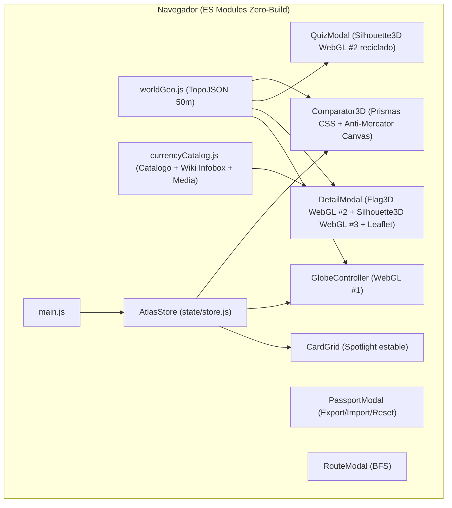

# Arquitectura Técnica y Estructura del Proyecto

Este documento describe la arquitectura implementada en **Atlas**, la organización modular **zero-build (ES Modules nativos)**, el pipeline de datos y billetes vigentes, el manejo de estado y caché, el ciclo de vida de contextos WebGL y las medidas de seguridad.

---

## 1. Arquitectura Zero-Build con ES Modules Nativos

Atlas funciona sobre cualquier servidor HTTP estático sin paso de compilación ni bundler. Emplea `<script type="importmap">` en [index.html](file:///c:/Users/Facundo/Downloads/Proyectos%20para%20Portfolio/Atlas/index.html) para resolver **Three.js `0.170.0`**, **`OrbitControls`** y **`topojson-client@3.1.0`**, junto con **Leaflet `1.9.4`**. Las escenas tridimensionales internas conviven con títulos de interfaz limpios (sin prefijos o sufijos `"3D"` visibles para el usuario).

### Estructura de archivos del proyecto

```text
Atlas/
├── index.html                        # Shell HTML, importmap ESM y 6 diálogos <dialog>
├── README.md                         # Descripción general y de qué se trata (sin detalles técnicos)
├── docs/                             # Documentación completa
│   ├── INDEX.md
│   ├── DISENO_3D_Y_VISUAL.md
│   ├── FUNCIONALIDADES_Y_MEJORAS.md
│   ├── ARQUITECTURA_Y_ESTRUCTURA.md
│   ├── API_Y_DATOS.md
│   └── GUIA_DE_USO_Y_DESPLIEGUE.md
└── src/
    ├── main.js                       # Orquestación, eventos globales, HUD del globo y Deep Linking
    ├── api/
    │   ├── cacheStore.js             # Caché en memoria + localStorage (TTL/stale) + Pasaporte + Quiz
    │   ├── countriesClient.js        # Países, población, timezones UTC, FX, Open-Meteo y Wikipedia ES
    │   ├── currencyCatalog.js        # Catálogo verificado de billetes/monedas + Wikipedia Infobox & media-list
    │   └── worldGeo.js               # Carga única TopoJSON 50m (con fusión de IDs) y proyección en km
    ├── state/
    │   └── store.js                  # Store observable por tópicos y preferencias del Globo
    ├── components/
    │   ├── globe3d.js                # Globo NASA WebGL, atmósfera Rayleigh, nubes, corona, balizas y arcos
    │   ├── flag3d.js                 # Bandera interactiva en tela GLSL y dispose()
    │   ├── silhouette3d.js           # Silueta geográfica extruida en pedestal y dispose()
    │   ├── cardGrid.js               # Grilla progresiva estable sin movimiento con foco de puntero
    │   ├── detailModal.js            # Cápsula Flip scrolleable, FX, visor/lightbox de billetes, clima, Wiki y Leaflet
    │   ├── objects3d.js              # Generadores HTML seguros de Escudo sin círculo, Moneda, Brújula y Clima
    │   ├── routeModal.js             # Calculador de rutas BFS y proyección de arcos al Globo
    │   ├── passportModal.js          # Progreso, Sellos coleccionables, Exportar, Importar y Reiniciar
    │   ├── comparator3d.js           # Dock flotante, Prismas proporcionales y Escala Real Anti-Mercator
    │   ├── quizModal.js              # Quiz Geográfico (Banderas, Capitales, Silueta, Fronteras)
    │   └── commandPalette.js         # Paleta Spotlight (Ctrl + K / ⌘ + K)
    ├── utils/
    │   ├── sanitize.js               # esc(), safeUrl() y isIso3()
    │   ├── formatters.js             # Normalización NFD, números/área/densidad, UTC, Haversine, bearing, WMO
    │   └── routing.js                # BFS bidireccional sobre borders y lectura/escritura de query params
    └── styles/
        ├── tokens.css                # Paletas por continente, fondo cartográfico y reduced-motion
        ├── layout.css                # Topbar, HUD del globo, barra de filtros, grilla, dock y modales
        └── objects3d.css             # Spotlight tarjetas, objetos de ficha, conversor FX, billetes/lightbox y Quiz
```

---

## 2. Flujo de Módulos, Divisas y Contextos WebGL



### Pipeline de Billetes y Monedas (`src/api/currencyCatalog.js`)
1. **Nivel 1 — Catálogo local verificado (`CURRENCY_CATALOG`)**: Divisas principales curadas manualmente con denominaciones actuales (por ejemplo `ARS` con sus 8 billetes vigentes del BCRA y `coins: []`, `USD`, `EUR`, `BRL`, `MXN`, `GBP`, `JPY`, `DZD`, etc.).
2. **Nivel 2 — Enriquecimiento en vivo desde Wikipedia (`fetchCurrencyWikiInfo`)**: Para cualquier divisa no listada en el catálogo curado, consulta `en.wikipedia.org/w/api.php` (`Infobox currency`) y extrae únicamente los campos de uso actual (`frequently_used_banknotes`/`used_banknotes`, `frequently_used_coins`/`used_coins` y `banknote_article`), manteniendo vacíos los listados ausentes sin inventar datos.
3. **Nivel 3 — Fotos reales por coincidencia estricta (`fetchCurrencyImages` + `attachBanknotePhotos`)**: Obtiene miniaturas desde Wikipedia REST `media-list`, excluye reversos/dorsos/sellos/notas antiguas o fraccionarias menores y vincula la foto solo cuando el archivo coincide con el valor nominal (eliminando falsos positivos por fechas como `2017-1-8`).

### Control estricto de contextos WebGL
Los navegadores limitan la cantidad de contextos WebGL simultáneos por pestaña. Por ello:
- El Globo Principal mantiene **1 contexto** persistente (que pausa su bucle cuando sale del viewport o cambia de pestaña).
- La Bandera (`flag3d.js`) y el Pedestal de Silueta (`silhouette3d.js`) ejecutan `dispose()` liberando geometrías, texturas y listeners y llamando a `renderer.forceContextLoss()` al cerrar el modal o avanzar de ronda en el Quiz.

---

## 3. Seguridad y Resiliencia

1. **Escape anti-XSS (`esc`)**: Todo texto proveniente de APIs o Wikipedia se escapa antes de inyectarse en el DOM.
2. **Validación de URLs (`safeUrl`) y códigos ISO (`isIso3`)**: Toda imagen externa (banderas, escudos, billetes BCRA/Wikimedia) y código leído por URL o JSON importado pasa por validación estricta de protocolo `http:`/`https:`.
3. **DOM semántico sin anidación inválida**: Cero manejadores inline (`onclick`/`onerror`) y estructura sin `<button>` anidados en las tarjetas de billetes (cuerpo selector + botón hermano de lupa `🔍`).
4. **Control de concurrencia (`renderToken` y `cashRenderToken`)**: Descarta respuestas asíncronas tardías si el usuario cambia rápido de país o de moneda en el conversor.
