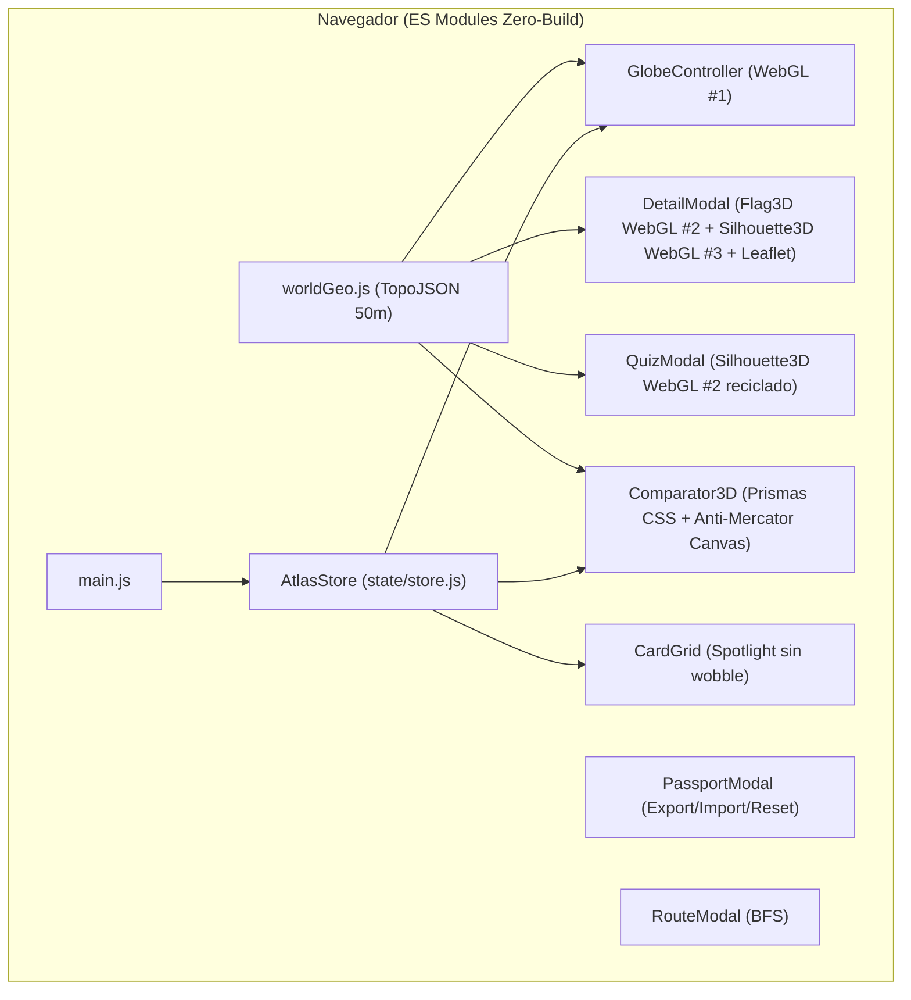

# Arquitectura Técnica y Estructura del Proyecto

Este documento describe la arquitectura implementada en **Atlas 3D**, la organización modular de archivos **zero-build (ES Modules nativos)**, la gestión de estado y caché, el ciclo de vida de los contextos WebGL y las medidas de seguridad.

---

## 1. Arquitectura Zero-Build con ES Modules Nativos

Atlas funciona sobre cualquier servidor HTTP estático sin herramientas de compilación. Utiliza `<script type="importmap">` en [index.html](file:///c:/Users/Facundo/Downloads/Proyectos%20para%20Portfolio/Atlas/index.html) para resolver **Three.js `0.170.0`**, **`OrbitControls`** y **`topojson-client@3.1.0`**, junto con **Leaflet `1.9.4`**.

### Estructura de archivos del proyecto

```text
Atlas/
├── index.html                        # Shell HTML, importmap ESM y 6 diálogos <dialog>
├── README.md                         # Descripción general y de qué se trata (sin detalles técnicos)
├── docs/                             # Documentación completa
│   ├── INDEX.md
│   ├── DISENO_3D_Y_VISUAL.md
│   ├── FUNCIONALIDADES_Y_MEJORAS.md
│   ├── ARQUITECTURA_Y_ESTRUCTURA.md
│   ├── API_Y_DATOS.md
│   └── GUIA_DE_USO_Y_DESPLIEGUE.md
└── src/
    ├── main.js                       # Orquestación, eventos globales y Deep Linking
    ├── api/
    │   ├── cacheStore.js             # Caché en memoria + localStorage (TTL/stale) + Pasaporte + Quiz stats
    │   ├── countriesClient.js        # Países, población, timezones, FX, Open-Meteo y Wikipedia ES
    │   └── worldGeo.js               # Carga única TopoJSON 50m y proyección igual-área en km
    ├── state/
    │   └── store.js                  # Store observable por tópicos
    ├── components/
    │   ├── globe3d.js                # Globo NASA 3D, nubes, estrellas, anillo, pines y arcos
    │   ├── flag3d.js                 # Bandera 3D con simulación de tela GLSL y dispose()
    │   ├── silhouette3d.js           # Silueta geográfica extruida 3D en pedestal y dispose()
    │   ├── cardGrid.js               # Grilla progresiva sin movimiento con foco de puntero
    │   ├── detailModal.js            # Cápsula Flip 180°, conversor FX, clima, Wiki y mapa Leaflet
    │   ├── objects3d.js              # Generadores HTML seguros de Escudo, Moneda, Brújula y Clima
    │   ├── routeModal.js             # Calculador de rutas BFS y proyección al Globo 3D
    │   ├── passportModal.js          # Progreso, Sellos 3D, Exportar, Importar y Reiniciar
    │   ├── comparator3d.js           # Dock flotante, Prismas 3D y Escala Real Anti-Mercator
    │   ├── quizModal.js              # Quiz Geográfico 3D (Banderas, Capitales, Silueta 3D, Fronteras)
    │   └── commandPalette.js         # Paleta Spotlight (Ctrl + K / ⌘ + K)
    ├── utils/
    │   ├── sanitize.js               # esc(), safeUrl() y isIso3()
    │   ├── formatters.js             # Normalización NFD, números/área/densidad, UTC, Haversine, bearing, WMO
    │   └── routing.js                # BFS bidireccional sobre borders y query params
    └── styles/
        ├── tokens.css                # Paletas por continente, fondo cartográfico y reduced-motion
        ├── layout.css                # Topbar, HUD del globo, barra de filtros, grilla, dock y modales
        └── objects3d.css             # Spotlight tarjetas, objetos 3D, conversor FX, anti-Mercator y Quiz
```

---

## 2. Flujo de Módulos y Contextos WebGL



### Control estricto de contextos WebGL
Los navegadores limitan los contextos WebGL simultáneos por pestaña. Por ello:
- El Globo Principal mantiene **1 contexto** persistente (que se pausa cuando sale del viewport o cambia de pestaña).
- La Bandera 3D (`flag3d.js`) y el Pedestal de Silueta 3D (`silhouette3d.js`) implementan `dispose()` llamando a `renderer.dispose()` y `renderer.forceContextLoss()`, además de liberar geometrías, texturas y listeners globales al cerrar cada modal o pasar de pregunta en el Quiz.

---

## 3. Seguridad y Resiliencia

1. **Escape anti-XSS (`esc`)**: Todo texto externo se escapa antes de insertarse en plantillas HTML.
2. **Validación de URLs (`safeUrl`) y códigos ISO (`isIso3`)**: Todas las imágenes, enlaces a Wikipedia y códigos recibidos desde URL o archivos JSON importados se validan estrictamente.
3. **Sin manejadores inline**: Cero atributos `onclick`/`onerror` en plantillas; confirmación de reinicio del Pasaporte implementada en DOM inline (2 clics) sin diálogos bloqueantes nativos.
4. **Control de concurrencia (`renderToken`)**: Descarta respuestas tardías de Open-Meteo, Wikipedia o GeoJSON si el usuario cambia rápido de país.
