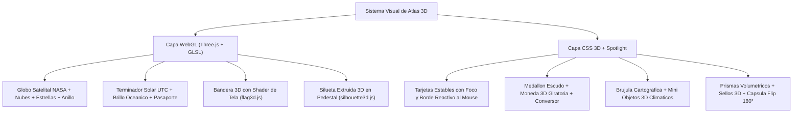

# Diseño 3D de Objetos y Sistema Visual

Este documento especifica el diseño estético, espacial y técnico de los **objetos tridimensionales y efectos visuales** implementados en **Atlas 3D**, combinando **WebGL (Three.js + GLSL)** y **CSS 3D (`preserve-3d`)** con foco en fluidez a 60 FPS, gestión segura de contextos GPU y accesibilidad.

---

## 1. Arquitectura Espacial Híbrida (WebGL + CSS 3D)

---

## 2. Catálogo Completo de Objetos 3D y Visuales

### Objeto 1 — Globo Terráqueo 3D Cinematográfico (`globe3d.js`)
- **Texturas Satelitales NASA + Fallback Instantáneo**: Inicia de inmediato con texturas procedurales `50m` y se actualiza en segundo plano con **NASA Blue Marble** (día), **NASA Black Marble** (luces urbanas nocturnas) y **mapa topográfico** (`earth-topology.png`) para sombreado de cordilleras.
- **Brillo Solar Oceánico (Blinn-Phong)**: Máscara oceánica generada desde `world-atlas 50m` para reflejar la luz del sol únicamente sobre mares y océanos.
- **Terminador Solar UTC Real en Shader GLSL**: Calcula la posición real del sol según la fecha y hora UTC, mezclando día y noche con una banda cálida de crepúsculo en el horizonte solar (con toggle a *Luz Completa*).
- **Overlay del Pasaporte y Fronteras `50m`**: Capa transparente `2048×1024` superpuesta que pinta en tiempo real países **Visitados** en dorado, **Por visitar** en esmeralda y el país activo en cian brillante.
- **Entorno Espacial**:
  - **Campo de estrellas 3D (`THREE.Points`)**: 1.600 estrellas distribuidas en esfera lejana (`R = 14..28`) con sprite suave y tintes estelares cálidos/fríos.
  - **Capa de nubes 3D (`SphereGeometry`)**: Nubes procedurales translúcidas rotando suavemente hacia el este.
  - **Anillo orbital cartográfico (`TorusGeometry`)**: Aro sutil inclinado `23.4°` teñido con el color del continente filtrado.
  - **Atmósfera Fresnel dinámica** + **Balizas `InstancedMesh` (1 draw call)** + **Arcos geodésicos animados (`QuadraticBezierCurve3`)**.

### Objeto 2 — Bandera 3D con Simulación de Tela (`flag3d.js`)
- Presente en la cabecera de la ficha de cada país (`WavingFlag3D`):
  - Mástil metálico cilíndrico con remate esférico dorado a la izquierda.
  - Malla subdividida (`PlaneGeometry(2.85, 1.85, 36, 22)`) anclada al mástil en `uv.x = 0`.
  - **Shader GLSL personalizado** con ondas senoidales compuestas y sombreado de pliegues calculado desde la derivada de la onda; mover el mouse sobre la bandera intensifica la brisa e inclina la tela suavemente.
  - Fallback automático a imagen `` si `prefers-reduced-motion` está activo o si falla WebGL.

### Objeto 3 — Silueta Geográfica Extruida 3D en Pedestal (`silhouette3d.js`)
- Presente en la ficha del país y en el modo *Silueta 3D* del Quiz (`CountrySilhouette3D`):
  - Toma el polígono real `50m` del país proyectado en kilómetros compensados por latitud (`projectFeatureToKm`), construye `THREE.ExtrudeGeometry` con bisel metálico y lo monta sobre un **pedestal circular holográfico** con anillos concéntricos.
  - Incluye un **pin luminoso 3D en la capital** (ocultado automáticamente en el Quiz para no dar pistas) y permite giro libre arrastrando con el cursor.

### Objeto 4 — Tarjeta Estable con Foco Luminoso de Mouse (`cardGrid.js` + `objects3d.css`)
- **Sin movimiento ni inclinación al pasar el mouse**: Se eliminó la rotación `rotateX`/`rotateY` en las tarjetas para garantizar estabilidad absoluta al leer y pulsar los botones de acción rápidos.
- **Efecto interactivo del puntero**: Al mover el mouse sobre cualquier tarjeta, `requestAnimationFrame` actualiza `--glare-x` y `--glare-y` para proyectar:
  1. Un **foco radial luminoso** sobre la superficie cristalina (`.card-glare`).
  2. Un **borde iluminado reactivo** mediante máscara CSS (`mask-composite: exclude` en `.card-border-glow`) que ilumina el perímetro más cercano al puntero.
  3. Un **acabado holográfico *foil*** dorado/esmeralda en los países del Pasaporte.

### Objeto 5 — Medallón de Escudo Nacional en Relieve (`coatOfArms`)
Disco con marco metálico cónico dorado, fondo oscuro y escudo SVG elevado a `translateZ(12px)`, con degradación automática a monograma `ISO-3` en relieve si el territorio no tiene escudo oficial.

### Objeto 6 — Moneda 3D Giratoria + Conversor (`objects3d.js`)
Moneda metálica tridimensional (`coin-3d`) con anverso (símbolo y código ISO), canto y reverso (`rotateY(180deg)`) con el nombre de la divisa, acompañada del botón **`💱 Convertir`** para desplegar el conversor en vivo.

### Objeto 7 — Brújula Cartográfica 3D + Reloj en Vivo
Rosa de los vientos (`N · E · S · O`) cuya aguja gira dinámicamente (`--bearing`) para **apuntar hacia el país limítrofe** seleccionado al hacer hover, junto al reloj local en tiempo real (`☀️` / `🌙`).

### Objeto 8 — Mini Objetos 3D Climáticos
Sol, luna nocturna, sol parcialmente nublado, nube volumétrica, lluvia con gotas animadas, nieve o tormenta según el código WMO en vivo de Open-Meteo.

### Objeto 9 — Prismas Volumétricos 3D + Comparador Anti-Mercator
Columnas isométricas tridimensionales centradas (frente, lateral y tapa unidos sin separación) para comparar **Población**, **Superficie** y **Densidad**, complementadas por un **lienzo comparativo igual-área en escala real** (`mercator-canvas`).

### Objeto 10 — Sellos 3D Coleccionables del Pasaporte
Insignias con borde punteado dorado o esmeralda e inclinación orgánica dentro del modal de Pasaporte.

### Objeto 11 — Cápsula Modal Flip 180° + *View Transitions API*
Entrada suavizada mediante *View Transitions API* (`document.startViewTransition`) y giro `180°` en eje Y entre **Cara A (Ficha + Objetos 3D)** y **Cara B (Mapa Leaflet oscuro con OpenStreetMap)**.

---

## 3. Paleta Atmosférica Dinámica y Gestión GPU

- **Temas dinámicos por continente** (`:root[data-region]`): Turquesa (Global), Esmeralda (`Americas`), Zafiro (`Europe`), Ámbar (`Africa`), Carmesí (`Asia`), Aguamarina (`Oceania`) e Índigo hielo (`Antarctic`).
- **Ciclo de vida WebGL limpio**: Tanto `WavingFlag3D` como `CountrySilhouette3D` implementan `dispose()` liberando geometrías, texturas, listeners de ventana y ejecutando `renderer.forceContextLoss()` para no saturar el límite de contextos WebGL del navegador al abrir múltiples países o jugar rondas sucesivas del Quiz.
- **Accesibilidad**: Respeto estricto a `@media (prefers-reduced-motion: reduce)` en CSS y en los tres módulos WebGL.
