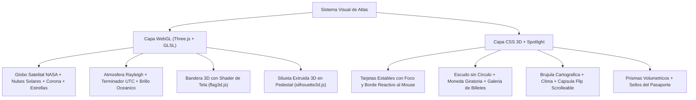

# Diseño de Objetos 3D y Sistema Visual

Este documento especifica el diseño estético, espacial y técnico de los **objetos tridimensionales, shaders y componentes visuales** implementados en **Atlas**, combinando **WebGL (Three.js + GLSL)** y **CSS 3D (`preserve-3d`)** con foco en fluidez a 60 FPS, limpieza visual en títulos, gestión segura de contextos GPU y accesibilidad.

---

## 1. Arquitectura Espacial Híbrida (WebGL + CSS 3D)

---

## 2. Catálogo Completo de Objetos 3D y Visuales

### Objeto 1 — Globo Terráqueo Cinematográfico (`globe3d.js`)
- **Texturas Satelitales NASA + Fallback Instantáneo**: Inicia al instante con texturas procedurales `50m` y se actualiza en segundo plano con **NASA Blue Marble** (día), **NASA Black Marble** (luces urbanas nocturnas potenciadas con `pow(nightCol, 0.88) * 1.95`) y **mapa topográfico** (`earth-topology.png`) para sombreado de cordilleras en tierra firme.
- **Brillo Solar Oceánico (Blinn-Phong)**: Máscara oceánica generada desde `world-atlas 50m` (`uWaterTex`) para reflejar el brillo especular del sol únicamente sobre mares y océanos.
- **Terminador Solar UTC Real en Shader GLSL**: Calcula la dirección real del sol (`getSunDirection`) según fecha y hora UTC, mezclando día, crepúsculo cálido y noche estrellada (alternable vía `🌗 Día/Noche Real`).
- **Atmósfera Rayleigh Suave (`1.11×R`)**: Halo atmosférico en cara posterior (`BackSide` + `AdditiveBlending`) cuyo brillo cae suavemente a `0` en el borde externo (`clamp((-dot(vNormal, vView)) / 0.434, 0.0, 1.0)`) para eliminar contornos duros y atenuarse en el hemisferio nocturno.
- **Capa de Nubes Solares (`SphereGeometry(1.015×R)`)**: Shader dedicado que recibe `uSunDir` para iluminar nubes en la cara diurna y atenuarlas en la nocturna (alternable vía `☁️ Nubes`).
- **Corona Solar + Campo Estelar + Anillo Orbital**: Sprite aditivo solar (`uSunDir * 14`), 1.600 estrellas tintadas (`R = 14..28`) y anillo orbital inclinado teñido con el color de la región activa.
- **Balizas Estilizadas `InstancedMesh` + Anillos de Selección y Hover**: Pins cónicos esbeltos (`CylinderGeometry(0.0042, 0.0018, 0.026, 8)`) con toggle `📍 Balizas`, anillo cian en país seleccionado, anillo dorado reactivo en hover y arcos geodésicos animados (`QuadraticBezierCurve3`).
- **Overlay del Pasaporte y Fronteras `50m`**: Capa transparente `2048×1024` que pinta países **Visitados** en dorado, **Por visitar** en esmeralda y el país activo en cian brillante.

### Objeto 2 — Bandera con Simulación de Tela WebGL (`flag3d.js`)
- En la cabecera de la ficha (`WavingFlag3D`): mástil metálico cilíndrico con remate esférico dorado, malla `PlaneGeometry(2.85, 1.85, 36, 22)` anclada en `uv.x = 0` y shader GLSL de ondas compuestas con sombreado dinámico al mover el cursor sobre la bandera.
- Fallback automático a `` si `prefers-reduced-motion` está activo o WebGL no está disponible.

### Objeto 3 — Silueta Geográfica Extruida en Pedestal (`silhouette3d.js`)
- Usada tanto en la ficha del país como en el modo *Silueta* del Quiz (`CountrySilhouette3D`):
  - Proyecta el polígono real `50m` en kilómetros compensados por latitud (`projectFeatureToKm`), construye `THREE.ExtrudeGeometry` con bisel metálico y lo monta sobre un pedestal circular holográfico con pin en la capital (ocultado en el Quiz).

### Objeto 4 — Tarjeta Estable con Foco Luminoso de Mouse (`cardGrid.js` + `objects3d.css`)
- **Sin movimiento ni inclinación al pasar el mouse**: Cero rotación `rotateX`/`rotateY` en las tarjetas para mantener estabilidad total sobre las banderas y botones de acción rápida.
- **Efecto interactivo del puntero**: Actualiza `--glare-x` y `--glare-y` con `requestAnimationFrame` para proyectar un foco radial luminoso (`.card-glare`), un borde reactivo con `mask-composite: exclude` (`.card-border-glow`) y un acabado holográfico *foil* en países del Pasaporte.

### Objetos 5 a 8 — Franja de Objetos Equilibrados en la Ficha (`.detail-objects-strip`)
Las 4 tarjetas de objetos comparten una altura mínima uniforme (`min-height: 224px`, `justify-content: space-between`) con el pie alineado en una misma fila visual:
1. **Escudo Nacional libre sin círculo (`.crest-logo-wrap`)**: SVG de `120×112 px` sin fondo circular ni borde contenedor, destacando su silueta real con `drop-shadow` y respaldo tipográfico `ISO-3`.
2. **Moneda Giratoria + Acceso al Conversor (`.object-pod--currency`)**: Moneda 3D de doble cara (`.coin-3d`), descripción compacta y botón en una sola línea `💱 Conversor y billetes`; hacer clic en cualquier parte de la tarjeta, moneda o botón despliega o contrae el panel.
3. **Brújula Cartográfica + Reloj UTC (`104×104 px`)**: Rosa de los vientos (`N · E · S · O`) cuya aguja rotatoria (`--bearing`) apunta hacia cada país limítrofe al hacer hover, sobre la píldora de hora local en vivo.
4. **Clima en Vivo (`96×96 px`)**: Mini esculturas animadas (sol, luna, nubes, gotas de lluvia, nieve y tormenta) sincronizadas con Open-Meteo.

### Objeto 9 — Galería de Billetes sin Recortes + Visor Ampliado (`detailModal.js` + `objects3d.css`)
- Cada tarjeta de billete (`.banknote-card`) usa `.banknote-photo-wrap` (`height: 118px`) con `object-fit: contain` en `.banknote-img`, asegurando que tanto infografías casi cuadradas del BCRA como billetes panorámicos de Wikimedia se muestren completos sin recortes laterales ni verticales.
- Incluye un botón superior discreto de lupa (`🔍`, `.banknote-zoom-btn`, hermano accesible del botón principal de carga) que abre `.banknote-lightbox` para inspeccionar el billete ampliado con título, motivo y cierre por clic exterior, botón `✕` o tecla `Escape`.
- Las monedas vigentes (`.circ-coin`) solo se renderizan cuando la divisa tiene monedas circulantes reales verificadas (`gold`, `silver`, `bronze`, `bimetal`).

### Objetos 10 y 11 — Prismas Volumétricos, Sellos del Pasaporte y Cápsula Flip Scrolleable
- **Prismas isométricos**: Columnas tridimensionales unidas sin separación en el Comparador para Población, Superficie y Densidad, junto al lienzo **Anti-Mercator**.
- **Sellos coleccionables**: Insignias punteadas en el Pasaporte.
- **Cápsula Modal Flip 180° (`max-height: 88vh; overflow-y: auto`)**: Cara A (ficha técnica + objetos + conversor/billetes scrolleable) y Cara B (mapa Leaflet oscuro con OpenStreetMap), con animación de entrada mediante *View Transitions API* y títulos limpios sin aclarar `"3D"`.

---

## 3. Paleta Atmosférica Dinámica, Identidad Visual y Gestión GPU

- **Temas dinámicos por continente** (`:root[data-region]`): Turquesa (Global), Esmeralda (`Americas`), Zafiro (`Europe`), Ámbar (`Africa`), Carmesí (`Asia`), Aguamarina (`Oceania`) e Índigo hielo (`Antarctic`).
- **Logo vectorial cartográfico + regreso al inicio (`#brand-home-link`)**: Emblema SVG propio (esfera meridiana con estrella de brújula dorada en cabecera y favicon); hacer clic en el logo o título **Atlas** cierra modales abiertos, restablece filtros/búsqueda y vuelve suavemente al inicio de la página.
- **Barras de desplazamiento temáticas (`tokens.css`)**: Scrollbars delgados y redondeados (`9px` en página principal y `7px` en `.dialog-panel`, `.flip-face` y `.cmd-list`) sin flechas nativas y tintados dinámicamente con `--accent-rgb` del continente activo, con respaldo `@supports not selector(::-webkit-scrollbar)` mediante `scrollbar-width` y `scrollbar-color`.
- **Ciclo de vida WebGL limpio**: `WavingFlag3D` y `CountrySilhouette3D` ejecutan `dispose()` + `renderer.forceContextLoss()` al cerrar modales o cambiar de pregunta en el Quiz.
- **Accesibilidad**: Respeto estricto a `@media (prefers-reduced-motion: reduce)` en CSS y WebGL.
