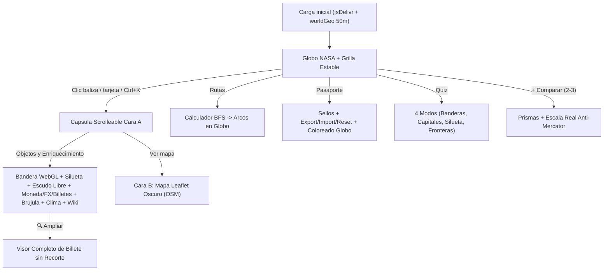

# Funcionalidades y Mejoras Implementadas

Este documento detalla todas las capacidades implementadas en **Atlas**, abarcando el núcleo exploratorio, el enriquecimiento en tiempo real, el visor de divisas y billetes vigentes sin datos ficticios, y los modos interactivos de exploración.

---

## 1. Núcleo Exploratorio y Usabilidad
- **Tarjetas estables con efecto interactivo de puntero**: Banderas nítidas sin desplazamiento ni inclinación al pasar el mouse, conservando foco luminoso radial y borde iluminado siguiendo el cursor (`--glare-x`, `--glare-y`).
- **Limítrofes con bandera y nombre completo en español**: Resueltos en $O(1)$ desde `countryIndex`. Hacer hover orienta la aguja de la brújula y resalta el arco en el globo; hacer clic navega directo al país vecino.
- **Búsqueda multilingüe sin tildes (`NFD`) con debounce**: Indexa nombres en español, oficial, inglés, nativo, capital y códigos ISO (`cca3`/`cca2`).
- **Filtros avanzados y ordenamiento multicriterio**: 6 continentes (incluyendo `Antarctic`), subregiones dinámicas, filtro de Pasaporte (`Todos`, `Visitados`, `Por visitar`) y orden ascendente/descendente por **Nombre**, **Población**, **Superficie (`km²`)** y **Densidad (`hab/km²`)**.
- **Renderizado progresivo por lotes**: Bloques de 24 tarjetas con `IntersectionObserver`, esqueletos de carga y botón para mostrar los restantes.
- **Deep Linking y Modo Aleatorio (`🎲 Sorpréndeme`)**: Sincronización de `?q=...&region=...&country=...` en la URL.

---

## 2. Enriquecimiento en Vivo, Divisas y Billetes Vigentes
1. **Clima en vivo de la capital (Open-Meteo)**: Temperatura, viento y estado meteorológico representados con esculturas CSS animadas.
2. **Resumen cultural en español (Wikipedia ES REST API)**: Extracto automático del país con enlace directo al artículo.
3. **Paleta de comandos rápida (`Ctrl + K` / `⌘ + K`)**: Buscador Spotlight por teclado para abrir países o lanzar acciones (Rutas, Quiz, Pasaporte, Aleatorio, Alternar Terminador Solar, Limpiar filtros).
4. **Transiciones suaves (*View Transitions API*)**: Despliegue fluido al abrir el detalle de un país.
5. **Conversor de divisas en vivo + Galería de Billetes y Monedas Vigentes**:
   - Accesible haciendo clic sobre toda la tarjeta de Moneda, la moneda giratoria o el botón `💱 Conversor y billetes`.
   - Convierte en tiempo real entre **166 monedas** (`open.er-api.com` con respaldo en Frankfurter y caché de 6 h).
   - **Sincronización dinámica de efectivo circulante**: Al cambiar el selector `Origen` o `Destino`, o al alternar las píldoras del selector superior en la sección de billetes, se actualiza automáticamente el catálogo visual de **billetes y monedas vigentes** de la divisa seleccionada.
   - **Carga rápida al conversor + Lupa de inspección**: Tocando cualquier billete o moneda se carga su valor en el campo de monto y se recalcula la conversión; pulsando el botón `🔍` en cualquier foto de billete se abre el visor ampliado sin recortes (`.banknote-lightbox`).
   - **Veracidad estricta (cero inventos)**: No se fabrican denominaciones genéricas ni monedas falsas. Por ejemplo, **Argentina (`ARS`)** muestra únicamente los 8 billetes oficiales del BCRA en circulación (`$100` a `$20.000`) sin sección de monedas (`coins: []`). Para divisas fuera del catálogo verificado, se consulta en vivo `Infobox currency` y `media-list` de Wikipedia; si no hay datos confiables, se informa limpiamente sin inventar cifras.

---

## 3. Experiencias Cartográficas y Modos Interactivos
1. **Globo Terráqueo Satelital con Terminador Solar UTC**: NASA Blue Marble / Black Marble, relieve topográfico, brillo solar oceánico, atmósfera Rayleigh suave, nubes solares animadas (`☁️ Nubes`), corona solar, 1.600 estrellas, anillo orbital y balizas `InstancedMesh` (`📍 Balizas`).
2. **Bandera con Simulación de Tela + Silueta Extruida en Pedestal**: Dentro de la ficha scrolleable de cada país se integran su bandera interactiva WebGL (`WavingFlag3D`) y su silueta `50m` extruida en pedestal con pin en la capital (`CountrySilhouette3D`).
3. **Calculador de Rutas Terrestres entre Fronteras**: Algoritmo **BFS** sobre `borders` que calcula la secuencia mínima de cruces fronterizos, compara distancia por tierra (`Haversine`) vs. vuelo directo y proyecta **arcos geodésicos dorados animados** en el Globo.
4. **Pasaporte de Viajero (Exportar, Importar y Reiniciar)**: Pinta países visitados (dorado) y por visitar (esmeralda) en el Globo, calcula avance global y por continente, agrupa sellos coleccionables e incorpora exportación/importación JSON y reinicio con confirmación inline.
5. **Comparador Volumétrico + Escala Real Anti-Mercator**: Contrasta 2 o 3 países mediante prismas proporcionales (Población, Superficie, Densidad), tabla comparativa y lienzo igual-área compensado por latitud (`cos(lat)`).
6. **Modo Quiz Geográfico (`🎮 Quiz`)**: 4 modos (*Banderas*, *Capitales*, *Silueta*, *Desafío de Fronteras*), vuelo automático del Globo al país revelado y récords de racha persistidos en `localStorage`.

---

## 4. Flujo Completo de Atlas

