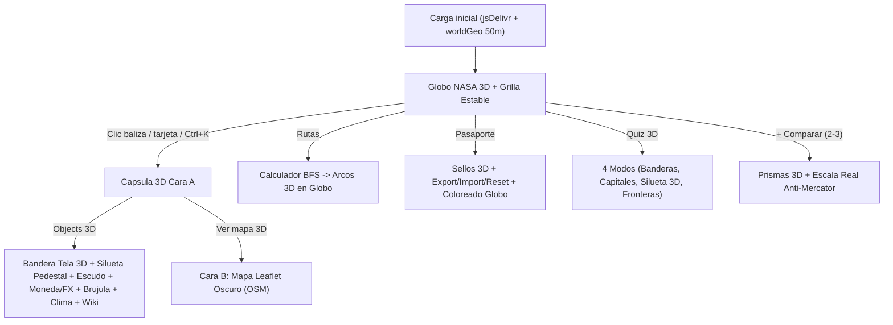

# Funcionalidades y Mejoras Implementadas

Este documento describe todas las capacidades implementadas en **Atlas 3D**, cubriendo la base exploratoria, las mejoras de **Impacto Inmediato**, los **3 Diferenciadores Fuertes** y las **6 mejoras de cierre** recién integradas.

---

## 1. Núcleo Exploratorio y Usabilidad
- **Tarjetas estables con efecto interactivo de puntero**: Banderas bien encuadradas sin rotación ni desplazamiento al pasar el mouse, conservando foco luminoso radial y borde iluminado siguiendo el cursor (`--glare-x`, `--glare-y`).
- **Limítrofes con bandera y nombre completo en español**: Resueltos en $O(1)$ desde `countryIndex`. Hacer hover orienta la aguja de la brújula 3D y resalta el arco en el globo; hacer clic viaja directamente al país vecino.
- **Búsqueda multilingüe sin tildes (`NFD`) con debounce**: Indexa español, oficial, inglés, nombre nativo, capital y códigos ISO (`cca3`/`cca2`).
- **Filtros avanzados y ordenamiento multicriterio**: Los 6 continentes (incluyendo `Antarctic`), subregiones dinámicas, modo de Pasaporte (`Todos`, `Visitados`, `Por visitar`) y orden ascendente/descendente por **Nombre**, **Población**, **Superficie (`km²`)** y **Densidad (`hab/km²`)**.
- **Renderizado progresivo por lotes**: Bloques de 24 tarjetas con `IntersectionObserver`, esqueletos 3D y botón para mostrar todos los restantes.
- **Deep Linking y Modo Aleatorio ("Sorpréndeme")**: Sincronización de `?q=...&region=...&country=...` en la URL.

---

## 2. Bloque de Alto Impacto y Enriquecimiento en Vivo
1. **Clima en vivo de la capital (Open-Meteo)**: Temperatura, viento y estado meteorológico representados con un **mini objeto 3D climático**.
2. **Resumen cultural en español (Wikipedia REST API)**: Síntesis automática del país con enlace al artículo completo.
3. **Paleta de comandos rápida (`Ctrl + K` / `⌘ + K`)**: Buscador Spotlight por teclado para saltar a cualquier país o ejecutar acciones (Rutas, Quiz 3D, Pasaporte, País aleatorio, Terminador Solar, Limpiar filtros).
4. **Transiciones suaves (*View Transitions API*)**: Animación fluida al desplegar la cápsula modal.
5. **Conversor rápido de divisas en la Moneda 3D**: Al pulsar `💱 Convertir`, consulta tasas reales (166 monedas vía `open.er-api.com` con fallback a Frankfurter y caché 6 h) para convertir bidireccionalmente entre la divisa del país y monedas globales (`USD`, `EUR`, `ARS`, `BRL`, `MXN`, `CLP`, `COP`, `UYU`, `GBP`, `JPY`).

---

## 3. Experiencias 3D y Diferenciadores de Portfolio
1. **Globo Terráqueo 3D Satelital con Terminador Solar UTC**: Combina texturas NASA Blue Marble / Black Marble, brillo solar sobre océanos, relieve topográfico, nubes 3D en movimiento, campo de 1.600 estrellas y anillo orbital.
2. **Bandera 3D Ondeando + Silueta Extruida en Pedestal**: Dentro del inspector de cada país se muestran su bandera en tela 3D interactiva (`WavingFlag3D`) y su silueta real `50m` extruida en 3D con pin en la capital (`CountrySilhouette3D`).
3. **Calculador de Rutas Terrestres entre Fronteras**: Algoritmo **BFS** sobre `borders` que calcula la secuencia mínima de cruces fronterizos, compara distancia terrestre (`Haversine`) vs. vuelo directo y proyecta **arcos geodésicos dorados animados** sobre el Globo 3D.
4. **Pasaporte de Viajero 3D (con Exportar, Importar y Reiniciar)**: Pinta en vivo países visitados (dorado) y por visitar (esmeralda) sobre el Globo 3D, muestra progreso global y por continente, colecciona **Sellos 3D** e incluye exportación/importación JSON y reinicio con confirmación inline de 2 pasos.
5. **Comparador Volumétrico 3D + Escala Real Anti-Mercator**: Contrasta 2 o 3 países con prismas isométricos 3D (Población, Superficie, Densidad), tabla técnica completa y un lienzo que superpone sus siluetas reales compensadas por latitud (`cos(lat)`) eliminando la distorsión de Mercator.
6. **Modo Quiz Geográfico 3D (4 Modos)**:
   - **Banderas** (4 opciones).
   - **Capitales** (4 opciones).
   - **Silueta 3D** (identificar el país girando su silueta extruida sin etiquetas ni pin).
   - **Desafío de Fronteras** (viajar paso a paso desde un origen hasta un destino en el mínimo número de saltos fronterizos).
   - En cada ronda el Globo 3D vuela al país revelado y guarda las **mejores rachas por modo** en `localStorage`.

---

## 4. Flujo Completo de Atlas 3D

