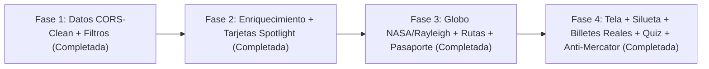

# Guía de Uso, Accesibilidad y Despliegue

Esta guía explica cómo ejecutar **Atlas** localmente, cómo publicarlo como sitio estático gratuito, qué controles ofrece cada vista y el estado completo de su hoja de ruta.

---

## 1. Ejecución Local

```powershell
# Opción 1: Python 3
python -m http.server 4173 --bind 127.0.0.1

# Opción 2: Node.js
npx serve . -l 4173
```

Abrí `http://127.0.0.1:4173` en el navegador. *(Durante desarrollo activo conviene evitar caché persistente de módulos ES deshabilitando caché en DevTools o sirviendo con `Cache-Control: no-store`.)*

---

## 2. Despliegue Estático (Zero-Build)

| Plataforma | Configuración |
| :--- | :--- |
| **GitHub Pages** | Settings → Pages → Source: `Deploy from a branch` (`main` / `/root`) |
| **Netlify** | Publish directory: `.` (sin comando de build) |
| **Vercel** | Framework Preset: `Other`, Output directory: `.` (sin comando de build) |
| **Cloudflare Pages** | Build command vacío, Build output directory: `.` |

---

## 3. Controles de Interacción y Atajos

- **Cabecera e Identidad**: Hacé clic en el **logo o título `Atlas`** para cerrar ventanas emergentes, limpiar búsqueda/filtros y regresar suavemente al inicio de la página.
- **Globo Terráqueo**: Arrastrar para orbitar, rueda/pellizco para zoom, hover sobre balizas para resaltado + tooltip y clic para abrir la ficha. Botones en HUD para alternar **`🌗 Día/Noche Real`**, **`☁️ Nubes`**, **`📍 Balizas`**, **`⏸ Pausar giro`** u **`Ocultar Globo`**.
- **Tarjetas de la grilla**: Permanecen quietas al pasar el cursor mientras proyectan foco luminoso y borde reactivo; accesos rápidos para **Visitado (`★`)**, **Por visitar (`⚑`)** y **Comparar (`+`)**.
- **Inspector de País (Cápsula Flip 180° con scroll vertical)**:
  - Mové el mouse sobre la **Bandera** para agitar la tela con el viento.
  - Arrastrá sobre el **Relieve en pedestal** para girar la silueta del país.
  - Hacé clic sobre toda la tarjeta de **Moneda**, la moneda giratoria o **`💱 Conversor y billetes`** para abrir el conversor en vivo y ver los **billetes y monedas vigentes** de la divisa seleccionada; tocá cualquier billete o moneda para cargar su valor en el monto, o el botón **`🔍`** para ver la imagen ampliada sin recortes (cerrable con `Escape` o clic fuera).
  - Pasá el cursor sobre **Países limítrofes** para orientar la **Brújula** y resaltar el arco en el globo; tocá **`🗺️ Ver mapa`** para girar hacia Leaflet.
- **Modo Quiz Geográfico (`🎮 Quiz`)**: Elegí entre *Banderas*, *Capitales*, *Silueta* o *Fronteras*; el globo vuela a cada respuesta.
- **Pasaporte (`🛂 Pasaporte`)**: Exportá o importá tu progreso en JSON o reiniciá los sellos mediante confirmación inline.
- **Comparador (`Comparar`)**: Muestra prismas volumétricos, tabla técnica y superposición en **Escala Real Anti-Mercator**.
- **Atajos de teclado**: `Ctrl + K` / `⌘ + K` abre la Paleta Spotlight; `Tab`, `Enter`, `Espacio` y `Escape` operan controles y modales. Respeta `prefers-reduced-motion: reduce`.

---

## 4. Roadmap de Implementación (Completado)



- [x] Arquitectura modular ES Modules zero-build con `importmap` (`Three.js` + `topojson-client` + `Leaflet`).
- [x] Cliente CORS-clean (`world-countries`, población, `countries-and-timezones`, `world-atlas 50m`, `Open-Meteo`, `Wikipedia ES/EN`, `open.er-api` FX).
- [x] Globo satelital NASA Blue/Black Marble, relieve topográfico, brillo solar oceánico, atmósfera Rayleigh suave, nubes solares (`☁️ Nubes`), corona solar, 1.600 estrellas, anillo orbital y balizas estilizadas (`📍 Balizas`).
- [x] Tarjetas estables sin movimiento con foco radial + borde reactivo al puntero + acabado holográfico *foil*.
- [x] Bandera con shader de tela + Silueta geográfica extruida en pedestal con pin en capital.
- [x] Cápsula scrolleable, títulos sin etiquetas `"3D"`, logo cartográfico con regreso al inicio, scrollbars temáticos en página y ventanas emergentes, Escudo nacional sin círculo, tarjetas equilibradas, Moneda giratoria + Conversor en vivo de 166 divisas, Brújula + Reloj UTC, Clima y Mapa Leaflet oscuro.
- [x] Catálogo real de **billetes y monedas vigentes** (BCRA oficial para Argentina sin monedas inexistentes + `Infobox currency` y `media-list` de Wikipedia sin fabricar valores ficticios), mostrado completo sin recortes (`object-fit: contain`) y con visor ampliado (`🔍`).
- [x] Calculador de Rutas BFS con arcos, Pasaporte (Export/Import/Reset), Quiz Geográfico (4 modos), Paleta `Ctrl + K` y Comparador con Escala Real Anti-Mercator.
