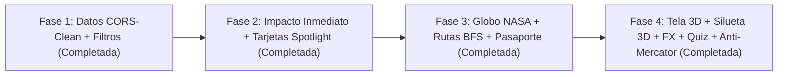

# Guía de Uso, Accesibilidad y Despliegue

Esta guía explica cómo ejecutar **Atlas 3D** localmente, cómo publicarlo como sitio estático gratuito, qué controles ofrece cada vista y el estado completo de su hoja de ruta.

---

## 1. Ejecución Local

```powershell
# Opción 1: Python 3
python -m http.server 4173 --bind 127.0.0.1

# Opción 2: Node.js
npx serve . -l 4173
```

Abrí `http://127.0.0.1:4173` en el navegador.

---

## 2. Despliegue Estático (Zero-Build)

| Plataforma | Configuración |
| :--- | :--- |
| **GitHub Pages** | Settings → Pages → Source: `Deploy from a branch` (`main` / `/root`) |
| **Netlify** | Publish directory: `.` (sin comando de build) |
| **Vercel** | Framework Preset: `Other`, Output directory: `.` (sin comando de build) |
| **Cloudflare Pages** | Build command vacío, Build output directory: `.` |

---

## 3. Controles de Interacción y Atajos

- **Globo Terráqueo 3D**: Arrastrar para orbitar, rueda/pellizco para zoom, hover sobre balizas para tooltip y clic para abrir la ficha. Botones en HUD para alternar **Día/Noche Real**, **Pausar giro** u **Ocultar Globo**.
- **Tarjetas de la grilla**: Permanecen estables al pasar el cursor mientras proyectan foco luminoso y borde reactivo; accesos rápidos para **Visitado (`★`)**, **Por visitar (`⚑`)** y **Comparar (`+`)**.
- **Inspector de País (Cápsula Flip 180°)**:
  - Mové el mouse sobre la **Bandera 3D** para agitar la tela con el viento.
  - Arrastrá sobre el **Pedestal de Silueta 3D** para girar el relieve del país.
  - Hacé clic en la **Moneda 3D** para girarla o en **`💱 Convertir`** para calcular cambios en vivo.
  - Pasá el cursor sobre **Países limítrofes** para orientar la **Brújula 3D** y resaltar el arco en el globo; tocá **`🗺️ Ver mapa 3D`** para girar hacia Leaflet.
- **Modo Quiz Geográfico 3D (`🎮 Quiz 3D`)**: Elegí entre *Banderas*, *Capitales*, *Silueta 3D* o *Fronteras*; el globo vuela a cada respuesta.
- **Pasaporte (`🛂 Pasaporte`)**: Exportá o importá tu progreso en JSON o reiniciá los sellos mediante confirmación inline.
- **Comparador (`Comparar en 3D`)**: Muestra prismas volumétricos 3D, tabla técnica y superposición en **Escala Real Anti-Mercator**.
- **Atajos de teclado**: `Ctrl + K` / `⌘ + K` abre la Paleta Spotlight; `Tab`, `Enter`, `Espacio` y `Escape` operan controles y modales. Respeta `prefers-reduced-motion: reduce`.

---

## 4. Roadmap de Implementación (Completado)



- [x] Arquitectura modular ES Modules zero-build con `importmap` (`Three.js` + `topojson-client` + `Leaflet`).
- [x] Cliente CORS-clean (`world-countries`, población, `countries-and-timezones`, `world-atlas 50m`, `Open-Meteo`, `Wikipedia ES`, `open.er-api` FX).
- [x] Globo 3D satelital NASA Blue/Black Marble, relieve topográfico, brillo solar oceánico, nubes 3D, campo de estrellas, anillo orbital y terminador solar UTC.
- [x] Tarjetas estables sin movimiento con foco radial + borde reactivo al puntero + acabado holográfico *foil*.
- [x] Bandera 3D con shader de tela + Silueta geográfica extruida 3D en pedestal con pin en capital.
- [x] Escudo 3D, Moneda 3D giratoria con conversor de 166 divisas, Brújula + Reloj UTC, Clima 3D y Mapa Leaflet oscuro.
- [x] Calculador de Rutas BFS con arcos 3D, Pasaporte 3D (con Exportar, Importar y Reiniciar), Quiz Geográfico 3D (4 modos), Paleta `Ctrl + K` y Comparador 3D con Escala Real Anti-Mercator.
