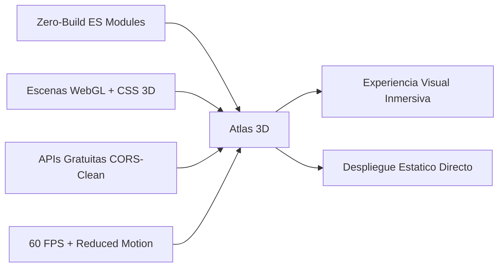

# Documentación de Atlas · Índice y Estado del Proyecto

Bienvenido a la documentación completa de **Atlas · Explorador Geopolítico y Cartográfico 3D**. Aquí se documentan la evolución del proyecto, los 11 objetos y escenas 3D implementados, las APIs gratuitas verificadas en navegador y la arquitectura modular sin paso de compilación (*zero-build*).

---

## 1. Evolución: Del Prototipo Inicial a Atlas 3D Completo

El prototipo inicial concentraba una grilla básica en un archivo HTML plano conectado a `restcountries.com/v3.1` (hoy deprecado por su proveedor). La versión actual implementa la plataforma completa de portfolio con escenas WebGL avanzadas y herramientas interactivas:

| Dimensión | Prototipo Inicial (v1) | Atlas 3D Actual (100% Implementado) |
| :--- | :--- | :--- |
| **Globo 3D Principal** | Inclinación simple de tarjetas | **Globo Terráqueo 3D WebGL (Three.js)** con NASA Blue Marble, luces nocturnas Black Marble, brillo solar oceánico, nubes 3D, campo de 1.600 estrellas, anillo orbital, atmósfera Fresnel, terminador solar UTC real, balizas `InstancedMesh` y arcos geodésicos |
| **Tarjetas en Grilla** | Tilt 3D con movimiento al pasar el mouse | **Tarjetas estables sin movimiento** (cero *wobble* al hacer clic) con **foco luminoso radial + borde iluminado** reactivos al puntero (`--glare-x`, `--glare-y`) y acabado holográfico en Visitados/Por visitar |
| **Objetos 3D en Ficha** | Bandera plana y texto básico | **Bandera 3D ondeando (shader de tela)**, **Silueta geográfica extruida 3D en pedestal**, **Medallón Escudo 3D**, **Moneda 3D giratoria con conversor de divisas en vivo**, **Brújula con *bearing* + Reloj UTC** y **Mini Objetos 3D Climáticos** |
| **Países limítrofes** | Códigos ISO sin contexto (`ARG`, `BRA`) | Insignias con **bandera + nombre en español**, orientación en vivo de brújula/globo y navegación continua |
| **Exploración y Juego** | Filtro básico de 5 continentes | **Calculador de Rutas Terrestres (BFS + Haversine)**, **Pasaporte de Viajero pintado en el Globo (export/import/reset)**, **Modo Quiz Geográfico 3D (4 modos)**, **Comparador 3D + Escala Real Anti-Mercator** y **Paleta `Ctrl + K`** |
| **Fuentes de Datos** | REST Countries v3.1 (deprecado) | Multi-fuente CORS-clean (`world-countries`, `country-by-population`, `countries-and-timezones`, `world-atlas 50m`, `Open-Meteo`, `Wikipedia ES`, `open.er-api`, `OpenStreetMap`) |

---

## 2. Mapa de Documentación

| Documento | Contenido |
| :--- | :--- |
| [DISENO_3D_Y_VISUAL.md](./DISENO_3D_Y_VISUAL.md) | Especificación de todos los objetos 3D implementados: Globo satelital con nubes y estrellas, Tarjetas con foco de puntero sin movimiento, Bandera 3D con shader de tela, Silueta extruida en pedestal, Escudo, Moneda, Brújula, Clima 3D, Prismas, Sellos y Cápsula Flip 180°. |
| [FUNCIONALIDADES_Y_MEJORAS.md](./FUNCIONALIDADES_Y_MEJORAS.md) | Detalle funcional completo: núcleo exploratorio, clima en vivo, Wikipedia ES, paleta `Ctrl + K`, rutas BFS, Pasaporte con export/import/reset, Conversor de divisas, Quiz Geográfico 3D (4 modos) y Comparador Anti-Mercator. |
| [ARQUITECTURA_Y_ESTRUCTURA.md](./ARQUITECTURA_Y_ESTRUCTURA.md) | Árbol completo de `src/`, arquitectura zero-build con `importmap`, gestión de contextos WebGL (`dispose` + `forceContextLoss`), caché con TTL y seguridad anti-XSS. |
| [API_Y_DATOS.md](./API_Y_DATOS.md) | Fuentes CORS-clean verificadas (países `50m`, NASA textures, Open-Meteo, Wikipedia ES, `open.er-api` / Frankfurter FX, OSM) y fórmulas matemáticas (Haversine, *bearing*, proyección igual-área en `km`). |
| [GUIA_DE_USO_Y_DESPLIEGUE.md](./GUIA_DE_USO_Y_DESPLIEGUE.md) | Ejecución local, despliegue estático, controles 3D/teclado, accesibilidad y estado del roadmap completado. |

---

## 3. Principios del Proyecto

