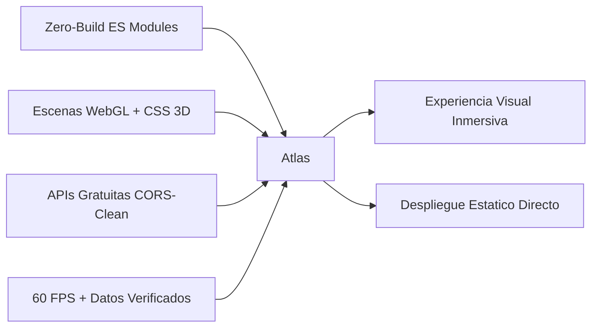

# Documentación de Atlas · Índice y Estado del Proyecto

Bienvenido a la documentación completa de **Atlas · Explorador Geopolítico y Cartográfico**. Aquí se documentan la evolución del proyecto, los objetos tridimensionales y escenas interactivas implementadas, las APIs gratuitas verificadas en navegador y la arquitectura modular sin paso de compilación (*zero-build*).

---

## 1. Evolución: Del Prototipo Inicial a Atlas Completo

El prototipo inicial concentraba una grilla básica en un archivo HTML plano conectado a `restcountries.com/v3.1` (hoy deprecado por su proveedor). La versión actual implementa la plataforma completa de portfolio con escenas WebGL avanzadas, limpieza visual en títulos (sin etiquetas "3D" innecesarias en la interfaz) y herramientas interactivas en vivo:

| Dimensión | Prototipo Inicial (v1) | Atlas Actual (100% Implementado) |
| :--- | :--- | :--- |
| **Identidad y Navegación** | Título plano sin enlaces ni barras custom | **Logo vectorial cartográfico** en cabecera/favicon con clic para volver al inicio y **scrollbars temáticos adaptativos** en página y modales |
| **Globo Terráqueo Principal** | Inclinación simple de tarjetas | **Globo WebGL (Three.js)** con NASA Blue Marble, luces nocturnas Black Marble, sombreado topográfico, brillo solar oceánico, dispersión atmosférica Rayleigh (`1.11×R`), nubes 3D iluminadas por el sol (`☁️ Nubes`), corona solar, 1.600 estrellas, anillo orbital, balizas estilizadas `InstancedMesh` (`📍 Balizas`), anillo hover y arcos geodésicos |
| **Tarjetas en Grilla** | Tilt 3D con movimiento al pasar el mouse | **Tarjetas estables sin movimiento** (cero *wobble* al hacer clic) con **foco luminoso radial + borde iluminado** reactivos al puntero (`--glare-x`, `--glare-y`) y acabado holográfico en Visitados/Por visitar |
| **Ficha del País (Cápsula Flip 180°)** | Bandera plana y texto básico | **Scroll fluido (`max-height: 88vh`)**, **Bandera animada en tela GLSL**, **Silueta geográfica extruida en pedestal**, **4 tarjetas equilibradas** (Escudo nacional libre sin círculo de fondo, Moneda giratoria, Brújula orientada + Reloj UTC, Clima en vivo) |
| **Divisa, Billetes y Monedas** | Texto simple sin cotización | **Conversor en vivo (166 divisas)** + **visor de billetes y monedas vigentes** (imágenes completas sin recorte + lupa ampliadora `🔍`, catálogo oficial BCRA + consulta viva a Wikipedia `Infobox currency` & `media-list`, sin inventar monedas ni valores inexistentes) |
| **Países limítrofes** | Códigos ISO sin contexto (`ARG`, `BRA`) | Insignias con **bandera + nombre en español**, orientación en vivo de brújula/globo y navegación continua |
| **Exploración y Juego** | Filtro básico de 5 continentes | **Calculador de Rutas Terrestres (BFS + Haversine)**, **Pasaporte de Viajero pintado en el Globo (export/import/reset)**, **Modo Quiz Geográfico (4 modos)**, **Comparador volumétrico + Escala Real Anti-Mercator** y **Paleta `Ctrl + K`** |
| **Fuentes de Datos** | REST Countries v3.1 (deprecado) | Multi-fuente CORS-clean (`world-countries`, `country-by-population`, `countries-and-timezones`, `world-atlas 50m`, `Open-Meteo`, `Wikipedia ES/EN`, `BCRA`, `open.er-api`, `OpenStreetMap`) |

---

## 2. Mapa de Documentación

| Documento | Contenido |
| :--- | :--- |
| [DISENO_3D_Y_VISUAL.md](./DISENO_3D_Y_VISUAL.md) | Especificación visual de escenas WebGL y CSS 3D: Globo satelital con atmósfera Rayleigh, nubes solares y balizas; Tarjetas con foco de puntero sin movimiento; Bandera en tela; Silueta extruida en pedestal; Escudo sin círculo; Moneda + Galería de billetes sin recortes; Brújula; Clima; Prismas; Sellos y Cápsula Flip scrolleable. |
| [FUNCIONALIDADES_Y_MEJORAS.md](./FUNCIONALIDADES_Y_MEJORAS.md) | Detalle funcional completo: núcleo exploratorio, clima en vivo, Wikipedia ES, paleta `Ctrl + K`, rutas BFS, Pasaporte con export/import/reset, Conversor de divisas con billetes/monedas vigentes y visor ampliado, Quiz Geográfico (4 modos) y Comparador Anti-Mercator. |
| [ARQUITECTURA_Y_ESTRUCTURA.md](./ARQUITECTURA_Y_ESTRUCTURA.md) | Árbol completo de `src/` (incluyendo `currencyCatalog.js`), arquitectura zero-build con `importmap`, gestión de contextos WebGL (`dispose` + `forceContextLoss`), caché con TTL y seguridad anti-XSS. |
| [API_Y_DATOS.md](./API_Y_DATOS.md) | Fuentes CORS-clean verificadas (países `50m`, NASA textures, Open-Meteo, Wikipedia ES/EN, BCRA + `media-list` de billetes, `open.er-api` / Frankfurter FX, OSM) y fórmulas matemáticas (Haversine, *bearing*, proyección igual-área en `km`). |
| [GUIA_DE_USO_Y_DESPLIEGUE.md](./GUIA_DE_USO_Y_DESPLIEGUE.md) | Ejecución local, despliegue estático, controles del Globo y teclado, accesibilidad y roadmap completado. |

---

## 3. Principios del Proyecto

